# MORPH: Intention-Aware Hands-Free Accessibility Interface

[](https://github.com/PrathamKapoor/MORPH/actions/workflows/ci.yml)
[](https://www.python.org/downloads/release/python-3120/)
[](https://www.microsoft.com/windows)
[](#privacy-and-safety)
[](#accessibility)

**MORPH** is a local, offline, webcam-based assistive computer access interface designed for individuals with severe motor disabilities. It enables users to train personalized facial and head gestures, normalizes movements against a resting neutral posture, and uses a deterministic intention-gating finite state machine to separate deliberate commands from ordinary, involuntary facial movements.

---

## The Problem: The "Midas Touch" in Camera-Based AAC

For individuals living with conditions such as Amyotrophic Lateral Sclerosis (ALS), cerebral palsy, or high-level spinal cord injuries, voluntary motor control may be limited to subtle facial or head movements. 

However, existing camera-based gesture recognition systems face a severe interaction barrier:
- **Natural Involuntary Movements**: Normal conversational speech, swallowing, yawning, eye blinks, and micro-spasms produce facial contractions that closely resemble command gestures.
- **Accidental Actuation**: Conventional systems trigger actions immediately upon a single frame exceeding a geometric threshold or neural classification score. In everyday use, this results in hundreds of accidental false activations per hour ($>200$ FA/hr), leading to user frustration, unintended speech output, and interaction fatigue.

---

## The Solution: Deterministic Intention Gating

MORPH solves the accidental activation problem by separating gesture perception from intention confirmation across five distinct architectural stages:

```mermaid
flowchart LR
    Cam[Standard Webcam] -->|RAM-only BGR| LM[Landmark Tracking]
    LM -->|478 Mesh Points| Norm[Scale Normalization]
    Norm -->|32D Feature Vector| Rec[Personalized Recognizer]
    Rec -->|Candidate Scores| FSM[Intention Engine FSM]
    FSM -->|Confirmed Command| Sand[Sandboxed Dispatcher]
    Sand -->|Audited Action| AAC[AAC Board & SAPI Speech]
```



1. **Facial Landmark Tracking**: Runs Google MediaPipe Face Landmarker locally on the CPU at 30 FPS, extracting 478 3D landmarks and verified blendshapes without writing video frames to disk.
2. **Personalized Gesture Recognition**: Maps anatomical landmarks relative to the user's calibrated resting neutral baseline, computing scale-invariant displacements normalized by inter-ocular distance.
3. **Temporal Intention Gating**: A pure mathematical 3-state Finite State Machine (FSM) that requires a candidate gesture to be held continuously above similarity threshold for $T_{hold}$ (default 250 ms), verified by a mandatory neutral release dwell ($T_{release} = 150$ ms) and refractory cooldown ($T_{cooldown} = 300$ ms).
4. **Safe Action Sandboxing**: A strictly typed dispatcher that permits only allow-listed internal actions (`NEXT_TILE`, `PREV_TILE`, `SELECT_TILE`, `SPEAK_TEXT`, `PAUSE`), rejecting any arbitrary OS command execution.
5. **Local Profile Adaptation**: SQLite-backed versioned profiles storing calibrated prototypes, ambiguity margins, and 1-click atomic rollback history.

---

## Key Capabilities

- **Personalized Gesture Enrollment**: Train up to 3 custom facial gestures (e.g. brow raise, smile, jaw drop) in under 2 minutes with 5 guided enrollment trials.
- **Anatomical Scale Invariance**: Inter-ocular normalization ensures consistent recognition regardless of user distance from the camera.
- **Geometric Conflict Detection**: Real-time pairwise cosine distance analysis warns users if two trained gestures overlap significantly.
- **Twitch Rejection**: Complete elimination of accidental activations from brief involuntary spasms (<150 ms) without requiring heavy neural networks.
- **Offline AAC Communication Board**: 9 high-contrast phrase tiles with rotary scanning and category hierarchies.
- **Local Speech Synthesis**: Utters confirmed phrases via Windows SAPI desktop voices (Microsoft David/Zira) with visual subtitle fallbacks.
- **Fail-Closed Safety**: Boots in a `PAUSED` state; immediate fallback to `TRACKING_LOST` within 33 ms if the face is occluded or multiple faces enter the frame.
- **Continuous Session Rest Advisor**: Non-medical fatigue tracker monitoring active communication duration with 20-minute rest reminders.
- **Auditable Benchmark Replay**: Built-in `ReplayEngine` providing exact frame-by-frame evaluation comparing generic thresholds, ungated classification, and intention gating.

---

## Technology Stack

| Component | Technology | Version | Purpose |
|---|---|---|---|
| **Runtime** | Python | 3.12.10 | Core language environment (64-bit) |
| **GUI Framework** | PySide6 (Qt for Python) | 6.8.0+ | WCAG 2.1 AAA accessible desktop interface |
| **Computer Vision** | OpenCV | 4.10.0+ | DirectShow optical camera frame acquisition |
| **Landmark Tracking** | Google MediaPipe | 0.10.14+ | 478-point 3D facial mesh & blendshape detection |
| **Vector Math** | NumPy | 2.0.0+ | Fast vectorized distance & normalization routines |
| **Persistence** | SQLite3 | Embedded | ACID versioned profile storage with atomic rollback |
| **Speech Output** | Windows SAPI / pyttsx3 | 2.98+ | Offline native Windows text-to-speech synthesis |
| **Distribution** | PyInstaller | 6.11.0+ | Standalone relocatable Windows desktop packaging |
| **Code Quality** | Pytest & Ruff | 9.0+ / 0.8+ | 170+ automated tests, linting, and formatting |

---

## System Requirements

- **Operating System**: Microsoft Windows 10 or Windows 11 (64-bit x64 native or ARM64 via Windows x64 emulation).
- **Python**: Version 3.12 (64-bit).
- **Camera**: Any standard DirectShow-compatible USB webcam or integrated laptop camera (640x480 at 30 FPS minimum).
- **Processor**: Dual-core x64 or ARM64 CPU (local inference requires ~15 ms per frame on standard modern processors).
- **Network**: None required. 100% offline operation.

---

## Installation & Setup

Clone the repository and set up a clean Python 3.12 virtual environment:

```powershell
# 1. Clone repository
git clone https://github.com/PrathamKapoor/MORPH.git
cd MORPH

# 2. Create and activate virtual environment
python -m venv .venv
.\.venv\Scripts\Activate.ps1

# 3. Install core dependencies and development tools
python -m pip install --upgrade pip
pip install -e .[dev]

# 4. Fetch and verify the MediaPipe model asset
powershell.exe -ExecutionPolicy Bypass -File .\scripts\fetch_models.ps1

# 5. Run system preflight health check
powershell.exe -ExecutionPolicy Bypass -File .\scripts\doctor.ps1
```

---

## Running MORPH

To launch the desktop application:

```powershell
# Standard launch with physical webcam
powershell.exe -ExecutionPolicy Bypass -File .\scripts\run.ps1

# Or directly via Python module
python -m morph

# Launch in simulated/no-camera demonstration mode
python -m morph --no-camera

# Run headless subsystem self-test
python -m morph --headless-check
```

---

## Step-by-Step User Workflow

1. **Launch**: Start MORPH and select your preferred optical camera from the Home screen.
2. **Profile Creation**: Create a new profile or select an existing one. The system initializes in the safe, fail-closed `PAUSED` state.
3. **Neutral Calibration**: Sit comfortably and face the camera in your natural resting posture. MORPH captures 30 frames to establish your resting baseline.
4. **Train Gestures**: Follow the guided enrollment wizard to capture 5 sustained repetitions for up to 3 custom movements (e.g. Brow Raise, Smile, Jaw Drop).
5. **Assign Actions**: Map each trained gesture to an AAC action (`NEXT_TILE`, `SELECT_TILE`, `PREV_TILE`).
6. **Practice Sandbox**: Test gestures in the non-executing Practice Mode with real-time similarity meters and FSM state feedback.
7. **Activate Control**: Click **Activate** (or press `Ctrl+A`). Deliberate gestures will now advance and select phrase tiles.
8. **Communication**: Selected tiles are spoken immediately via offline Windows SAPI voices.
9. **Safe Pause**: Press **Spacebar** or **Escape** at any moment for an immediate emergency freeze.

---

## Testing & Quality Assurance

MORPH maintains a comprehensive automated test suite with 100% pass rate:

```powershell
# Execute complete unit, integration, and smoke test suites
pytest -v

# Run code style formatting and lint checks
ruff check .
ruff format --check .

# Run distribution packaging and relocation tests
pytest -v tests/smoke/test_distribution.py
```

---

## Research Methodology & Empirical Findings

MORPH includes an empirical research evaluation harness (`ReplayEngine`) that replays standardized synthetic perturbation challenges across three controlled conditions:

- **Condition A (Generic Thresholds)**: Hardcoded anatomical displacements triggering immediately.
- **Condition B (Personalized Prototype)**: User-calibrated cosine similarity classifier triggering immediately.
- **Condition C (MORPH)**: Identical predictions from Condition B passed through the deterministic Intention Gate ($T_{hold} = 250$ ms, $T_{release} = 150$ ms, $T_{cooldown} = 300$ ms).

### Canonical 118.05s Replay Benchmark Results

| Metric | Condition A (Generic) | Condition B (Personalized) | Condition C (MORPH FSM) |
|---|:---:|:---:|:---:|
| **True Positives (TP)** | 4 | 4 | 4 |
| **False Positives (FP)** | 7 | 4 | **0** |
| **False Negatives (FN)** | 0 | 0 | 0 |
| **Recall** | 100.0% | 100.0% | **100.0%** |
| **Precision** | 36.4% | 50.0% | **100.0%** |
| **False Activation Rate** | **216.40 FA/hr** | **123.66 FA/hr** | **0.00 FA/hr** |
| **Two-Sided 95% Garwood CI** | [86.99, 445.87] FA/hr | [33.69, 316.60] FA/hr | **[0.00, 114.04] FA/hr** |
| **Median Confirmation Latency** | 0.0 ms | 0.0 ms | **266.7 ms** |

> [!NOTE]
> All reported false activation rates are derived from the canonical 118.05-second benchmark challenge replayed through the deterministic evaluation harness. Garwood Poisson confidence intervals are mathematically derived for exact small-sample statistical validity.

---

## Privacy and Safety

- **Zero Video Persistence (ADR-002)**: Camera frames exist solely in volatile heap memory and are immediately freed after landmark inference. Zero video files, temporary images, or raw frames are ever saved to disk or transmitted over the network.
- **100% Local & Offline**: All MediaPipe landmark detection, feature normalization, and SAPI speech synthesis execute entirely on the local machine with zero external cloud API dependencies.
- **Action Sandboxing**: The `ActionDispatcher` strictly enforces an allow-list of internal navigation and speech actions, mathematically preventing shell script execution.

---

## Known Limitations & Disclaimers

1. **Not a Certified Medical Device**: MORPH is an engineering and accessibility research application. It is not certified as a diagnostic instrument, medical device, or life-support system.
2. **Lighting Sensitivity**: MediaPipe Face Landmarker requires adequate ambient lighting (>15 lux). Severe backlighting or complete darkness triggers the fail-closed `TRACKING_LOST` state.
3. **Head Pose Boundaries**: Head rotations exceeding $\pm 45^\circ$ yaw or $\pm 30^\circ$ pitch cause landmark self-occlusion, safely pausing gesture interpretation.
4. **Clinical Validation Pending**: While benchmark replay evaluation and physical camera performance are fully validated, formal longitudinal clinical trials with individuals living with ALS/cerebral palsy are pending formal institutional review board (IRB) recruitment.

---

## Documentation Index

Comprehensive technical documentation is organized by engineering responsibility:

- **Architecture & System Design**:
  - [System Overview & Feature Schema](docs/architecture/overview.md)
  - [Detailed Execution & State Machine Flows](docs/architecture/flow.md)
  - [Architecture Decision Records (ADRs)](docs/architecture/decisions.md)
  - [Product Requirements & Traceability](docs/architecture/requirements.md)
- **Research & Scientific Integrity**:
  - [Research Methodology & Poisson Statistics](docs/research/methodology.md)
  - [Consolidated Experiment Log (EXP-001 – EXP-004)](docs/research/experiments.md)
  - [Empirical Benchmarks & Hardware Performance](docs/research/benchmarks.md)
  - [Real-World Study Protocol & Consent](docs/research/study_protocol.md)
  - [Research Limitations & Readiness Tiers](docs/research/limitations.md)
- **Accessibility & Interaction**:
  - [WCAG 2.1 AAA Accessibility Audit](docs/accessibility/audit.md)
  - [User & Caregiver Interaction Guide](docs/accessibility/guide.md)
- **Security & Privacy**:
  - [Zero-Video Privacy Audit & Invariants](docs/security/privacy.md)
  - [Security Architecture & Threat Model](docs/security/threat_model.md)
- **Development & Release**:
  - [Verification & Manual Test Plan](docs/development/testing.md)
  - [Production Packaging & Release Checklist](docs/development/building.md)
  - [Environment Setup & Troubleshooting](docs/development/troubleshooting.md)
  - [10-Stage Live Demonstration Script](docs/development/demo_guide.md)
  - [Third-Party Open-Source Notices](docs/development/third_party_notices.md)

---

## License & Attribution

- **Third-Party Notices**: Built using Google MediaPipe (Apache 2.0), OpenCV (Apache 2.0), PySide6 (LGPLv3), and NumPy (BSD-3-Clause). See [Third-Party Notices](docs/development/third_party_notices.md) for full license texts.
- **Copyright & Author**: Pratham Kapoor ([prathamkapoor027@gmail.com](mailto:prathamkapoor027@gmail.com)).
