# MORPH 2.0 Execution & Architecture Flows

Author: Pratham Kapoor <prathamkapoor027@gmail.com>  
System: Windows 10/11 Local Offline AAC System  
Location: `C:\Pratham\MORPH`

---

## 1. System Architecture & End-to-End Data Pipeline

The MORPH 2.0 pipeline runs entirely locally and offline, ensuring deterministic execution and absolute user privacy. Raw video frames exist solely in volatile memory and are immediately freed after landmark extraction.

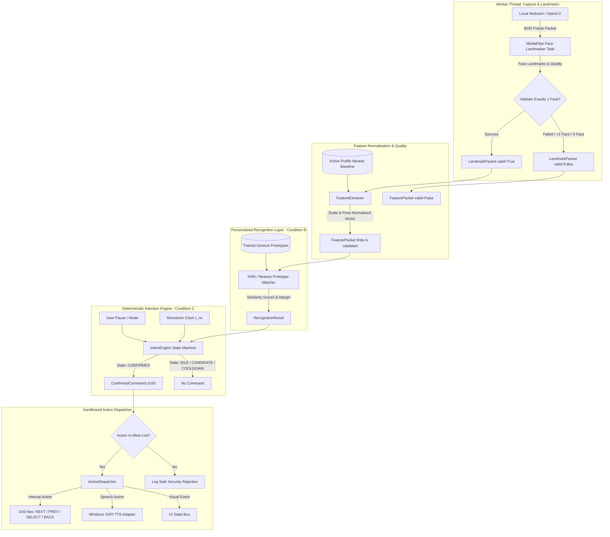

---

## 2. Application Lifecycle & UI Navigation Flow

The app starts strictly in the **PAUSED** state. No camera tracking or background processing may trigger commands before explicit user activation.

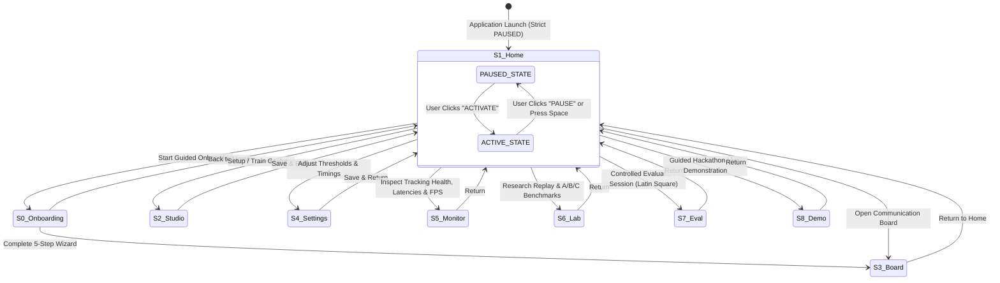

### Screen Responsibilities
- **S0 (Onboarding Wizard)**: 5-step guided walkthrough: privacy disclosure, webcam positioning, resting neutral check, 3-gesture calibration, and practice trial.
- **S1 (Home)**: Profile management, activation state toggle, camera/model health summary, route navigation.
- **S2 (Gesture Studio)**: Guided enrollment of resting neutral baseline + 3 gestures (5–10 samples each), ambiguity conflict detector, practice sandbox.
- **S3 (Communication Board)**: High-contrast 2D grid phrase tiles, offline Windows SAPI TTS, direct visual feedback, single-switch auto-scan.
- **S4 (Recognition Settings)**: Adjust $T_{hold}$, $T_{release}$, $T_{cooldown}$, similarity threshold, and ambiguity margins.
- **S5 (Reliability Monitor)**: Processed FPS, capture FPS, stage latencies, FSM badge, hold progress bar, DecisionReason breakdown, and raw vector similarities/distances.
- **S6 (Research Lab)**: Consented session recording, A/B/C replay benchmark with fair event-level debouncing and multi-factor ablations, JSON/CSV exports.
- **S7 (Controlled Evaluation)**: Participant consent gating, anonymized participant ID generation, automated task cueing runner, real-time ground truth event logging, and zero-residue session wipe.
- **S8 (Hackathon Demonstration)**: Automated preflight hardware checks (camera, MediaPipe, SAPI TTS, FSM fail-closed) and 7-stage guided talk-track demonstration.

---

## 3. Gesture Enrollment & Neutral Calibration Flow

To prevent accidental activation, gestures are calibrated relative to the user's natural resting face.

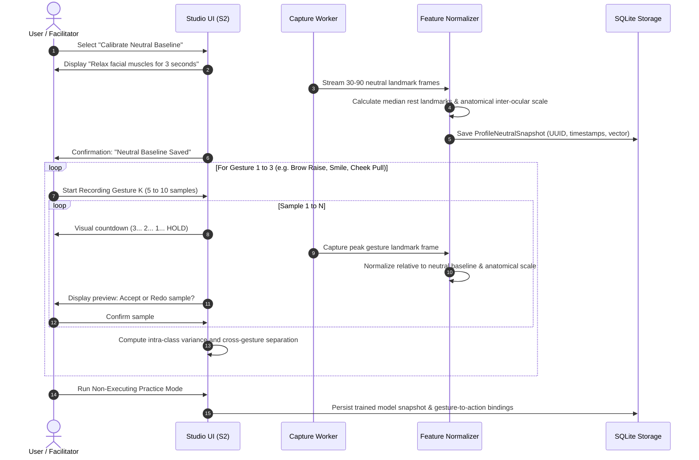

---

## 4. Deterministic Intent State Machine Flow (Condition C)

The pure finite-state machine enforces explicit intentionality before any command can be emitted.

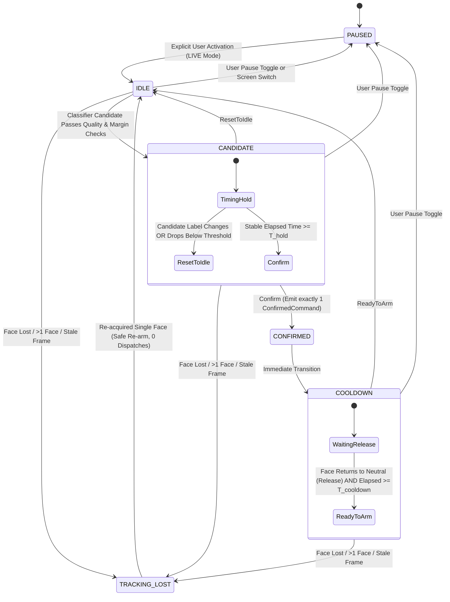

---

## 5. Offline Action Dispatch & Communication Flow

All execution routes through the isolated `ActionDispatcher`. No recognition thread or UI event handler executes actions directly.

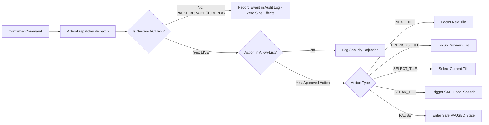

---

## 6. Failure & Safety Suppression Flow

To guarantee safety for users with motor disabilities, MORPH enforces a fail-closed architecture:
1. **Camera Disconnection / Stale Frames**: If frame timestamp delta exceeds 150 ms or camera returns empty frame, state shifts instantly to `TRACKING_LOST`. Any ongoing hold is purged.
2. **Multiple Faces in Frame**: If a caregiver or passerby enters the frame ($N > 1$), all tracking validity drops to `False`. Command emission is strictly blocked.
3. **Ambiguous Classification / Tied Scores**: If the margin between the top two gesture candidates is below `min_margin` ($\Delta < 0.15$), the candidate is rejected with reason `AMBIGUOUS_CONFLICT`.
4. **Out-of-Order Packets**: Packets with monotonic timestamps less than or equal to the previous frame are discarded immediately.
5. **Reconnection / Unpause**: Transitioning from `TRACKING_LOST` or `PAUSED` back to `IDLE` requires a minimum of 200 ms of continuous valid resting neutral tracking before any new candidate can be admitted.

---

## 7. Controlled Research Replay & A/B/C Evaluation Flow

To empirically answer the core research question, evaluation sessions replay recorded feature packets across all three conditions without human bias.

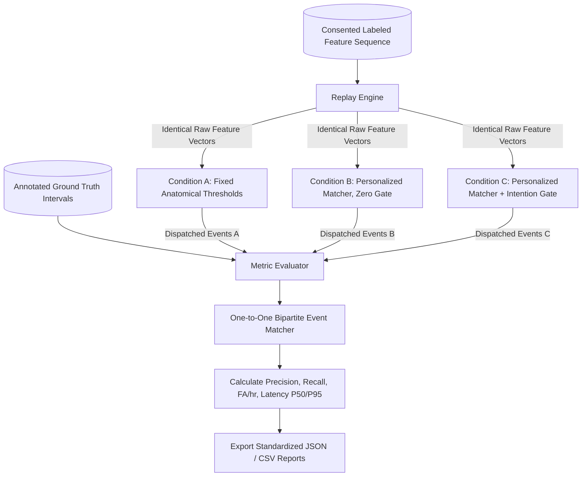

---

## 8. Safe Personalization, Posture Drift & Rollback Flow

Cross-session anatomical drift and lighting shifts are handled through non-medical, explainable calibration checks and atomic versioning.

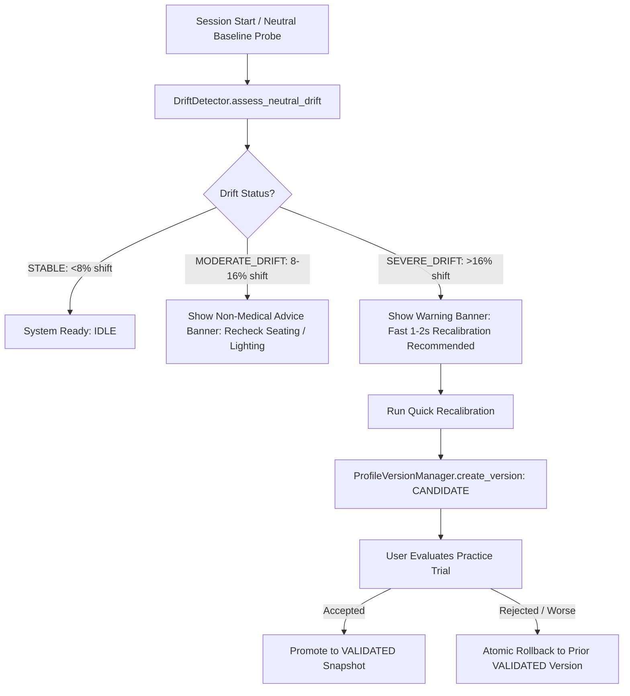

---

## 9. Accessible Error Recovery & Safety Notification Flow

Instead of modal popups that steal screen reader focus, non-blocking high-contrast banners provide actionable recovery steps.

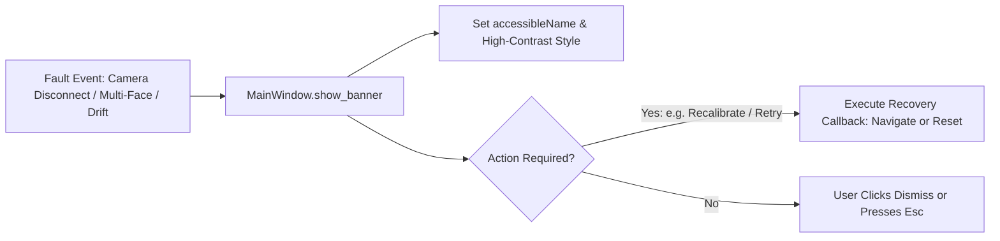

---

## 10. Controlled Real-World Study & Live Demonstration Flows

### 10.1 Real-World Study Execution Flow
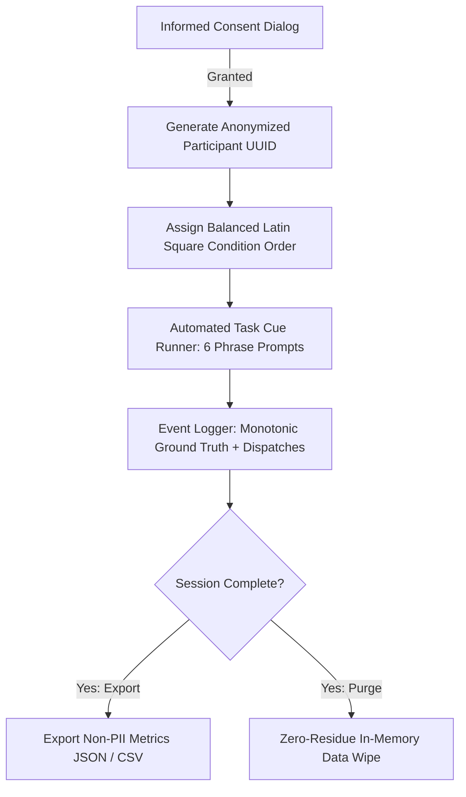

### 10.2 Safe Live Demonstration Flow
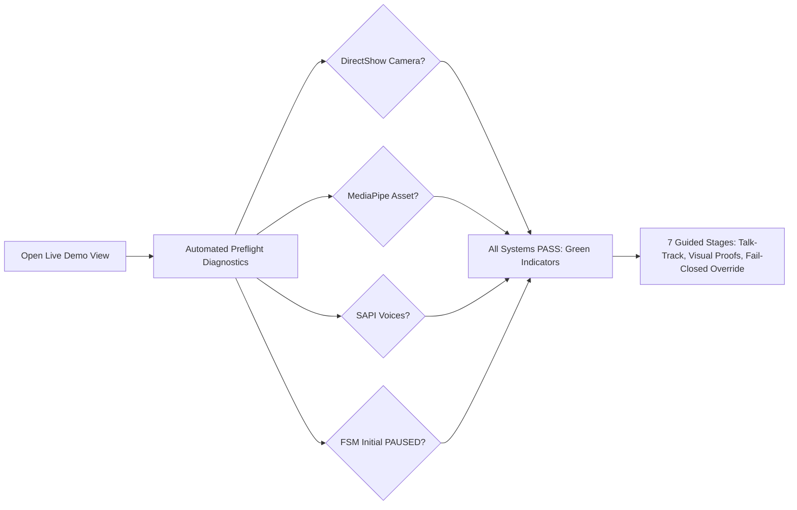

---

## 11. Rest Advisor & Continuous Session Ergonomics Flow (Milestone M7)

To prevent facial muscle strain or fatigue during extended communication sessions (PRD D09), `RestAdvisor` runs a non-medical continuous duration monitor:

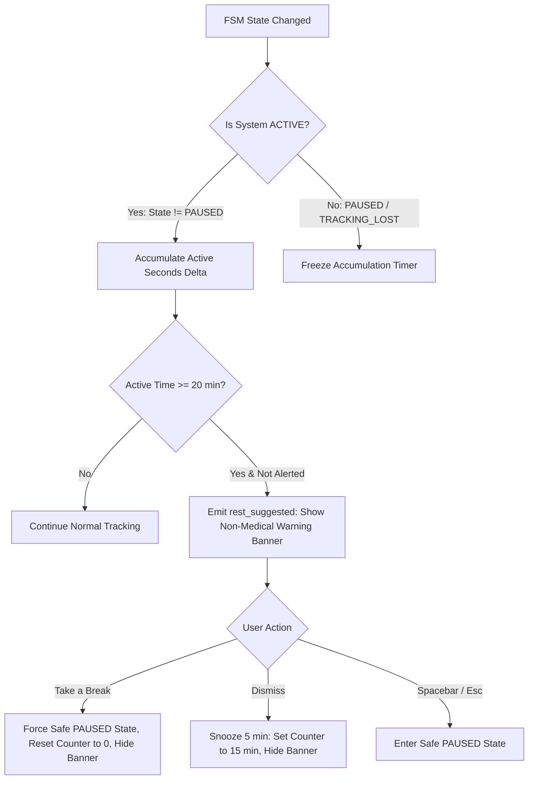

---

## 12. Sustained Multi-Stage Performance Measurement & Telemetry Flow (Milestone M8.1)

Decouples optical camera driver wait from computational inference and intention gating via nanosecond-precision `PipelineStageTelemetry`:

```mermaid
flowchart TD
    subgraph OpticalSensor ["Hardware & Driver (Optical Integration)"]
        T0["t_read_start (Driver Entry)"] --> CamRead["cv2.VideoCapture.read() (Sensor Shutter Wait ~82ms)"]
        CamRead --> T1["t_capture (Monotonic Arrival)"]
    end

    subgraph BoundedQueue ["Bounded Queue Subsystem"]
        T1 --> T_qin["t_queue_insert"]
        T_qin --> RingBuf["Bounded Deque (Max Depth: 3)"]
        RingBuf --> T_qout["t_queue_remove (< 2 us)"]
    end

    subgraph ComputePipeline ["Zero-Wait Compute Engine (~17 ms Total)"]
        T_qout --> T_inf0["t_infer_start"]
        T_inf0 --> MP["MediaPipe FaceLandmarker (~15.9 ms)"]
        MP --> T_inf1["t_infer_end"]
        
        T_inf1 --> T_feat0["t_feat_start"]
        T_feat0 --> Norm["FeatureExtractor & Baseline (~0.07 ms)"]
        Norm --> T_feat1["t_feat_end"]
        
        T_feat1 --> T_rec0["t_recog_start"]
        T_rec0 --> Rec["Personalized Classifier (~0.02 ms)"]
        Rec --> T_rec1["t_recog_end"]
        
        T_rec1 --> T_int0["t_intent_start"]
        T_int0 --> FSM["Deterministic Intent Engine (~0.02 ms)"]
        FSM --> T_int1["t_intent_end"]
    end

    subgraph DispatchPresentation ["Sandboxed Dispatch & UI Presentation"]
        T_int1 --> T_disp0["t_dispatch_start"]
        T_disp0 --> Sink["Sandboxed Action Sink (< 1 us)"]
        Sink --> T_disp1["t_dispatch_end"]
        T_disp1 --> T_ui["t_ui_ack"]
    end
```

---

## 13. User-Specific Guided Parameter Calibration & Rollback Architecture (M8.4)

Balances sensitivity, false-activation rejection, latency, and holding comfort with atomic SQLite version control:

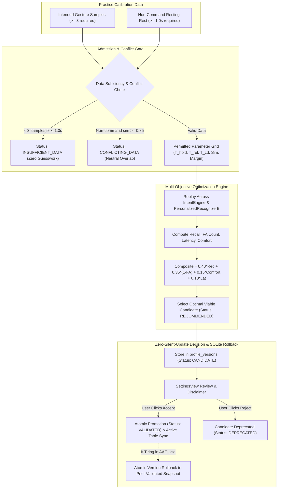

