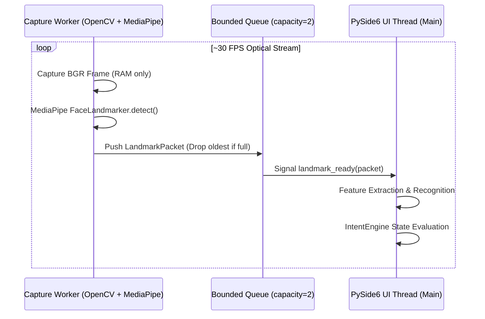

# MORPH 2.0 System Architecture & Technical Specifications

**Author**: Pratham Kapoor <prathamkapoor027@gmail.com>  
**System Target**: Windows 10/11 Local Offline AAC System  
**Repository**: `https://github.com/PrathamKapoor/MORPH`  
**Schema Version**: `morph-features-v1.0`

---

## 1. Architectural Philosophy

MORPH 2.0 is designed around four core architectural principles:

1. **Deterministic Pure Core**: The intention engine and classifier evaluation logic are pure Python functions and deterministic finite-state machines, completely decoupled from I/O, threads, and UI widgets.
2. **Strict Memory-Bound Sensor Shell**: Camera frames are processed on a dedicated background worker thread with bounded ring buffers (capacity = 2) and oldest-frame drop semantics to eliminate UI stutter and latency lag.
3. **Single Point of Side-Effect Execution**: All state mutations and external actions (TTS, grid navigation) flow through a sandboxed `ActionDispatcher` that validates allow-lists and deduplication.
4. **Offline and Zero-Persistence by Default**: No network sockets, zero telemetry, and zero raw video files on disk. Raw webcam frames exist solely in volatile RAM and are immediately freed after landmark extraction.

---

## 2. Directory Layout & Module Responsibilities

```
src/morph/
├── common/             # Immutable data contracts, monotonic clocks, config schemas
├── capture/            # OpenCV video worker, MediaPipe FaceLandmarker task adapter
├── features/           # Anatomical normalization, scale invariants, quality filtering
├── recognition/        # Baseline A (fixed), Baseline B (personalized), calibration
├── intent/             # Pure FSM Intention Engine, hold/release timers, arbitration
├── actions/            # Allow-listed dispatcher, Windows SAPI TTS, NoOp sink
├── storage/            # SQLite migrations, user profiles, phrase decks, version rollback
├── ui/                 # PySide6 accessible interfaces (Home, Studio, Board, Settings, Monitor, Lab)
└── evaluation/         # Consented recorder, A/B/C replay harness, precision/recall/latency metrics
```

---

## 3. Data Pipeline & Inter-Module Contracts

The end-to-end processing pipeline transforms raw optical capture into verified user actuation:


### 3.1 Common Data Types (`src/morph/common/types.py`)
- `FramePacket`: `(frame_id: int, captured_at_monotonic_ns: int, bgr_image: np.ndarray, source_id: str)`
- `LandmarkPacket`: `(frame_id: int, t_ns: int, face_count: int, normalized_landmarks: np.ndarray, blendshapes: dict, valid: bool, failure_reason: str)`
- `FeaturePacket`: `(frame_id: int, t_ns: int, schema_version: str, vector: np.ndarray, valid: bool, quality: float, failure_reason: str)`
- `RecognitionResult`: `(frame_id: int, t_ns: int, label_scores: dict[str, float], best_label: str, second_label: str, accepted_candidate: str | None, reject_reason: str)`
- `IntentTransition`: `(t_ns: int, before: State, after: State, label: str | None, reason: str, frame_id: int)`
- `ConfirmedCommand`: `(command_event_uuid: str, frame_id: int, confirmed_at_ns: int, gesture_uuid: str, action_name: str, profile_version_id: str)`
- `ActionResult`: `(command_event_uuid: str, action_name: str, dispatched_at_ns: int, success: bool, error_code: str)`

---

## 4. Feature Normalization & Scale Invariance

The feature vector $\mathbf{x} \in \mathbb{R}^{32}$ (or 45D extended) is a compact, noise-robust, scale-invariant representation derived from MediaPipe 478-point facial landmarks and verified blendshapes.

### 4.1 Anatomical Normalization
1. **Inter-Ocular Reference Distance ($D_{eye}$)**:
   $$D_{eye} = \sqrt{(x_{263} - x_{33})^2 + (y_{263} - y_{33})^2 + (z_{263} - z_{33})^2}$$
   If $D_{eye} < 10^{-4}$ (e.g. face undetected or numerical fault), the feature packet is marked invalid.

2. **Neutral-Relative Offset**:
   For any landmark $i$, the normalized displacement relative to the user's calibrated resting neutral baseline is:
   $$\Delta \mathbf{p}_i = \frac{\mathbf{p}_i^{(current)} - \mathbf{p}_i^{(neutral)}}{D_{eye}}$$

3. **Geometric & Blendshape Sub-Vectors**:
   - Eyebrow elevations ($\Delta y_{105}, \Delta y_{334}$) and asymmetry.
   - Mouth vertical opening ($\Delta y_{14} - \Delta y_{13}$) and horizontal width ($\Delta x_{291} - \Delta x_{61}$).
   - Left and right mouth corner displacement.
   - Blendshapes: `browInnerUp`, `mouthSmileLeft`, `mouthSmileRight`, `jawOpen`, `mouthPucker`, `eyeBlinkLeft`, `eyeBlinkRight`.

---

## 5. Concurrency & Threading Model

To ensure responsiveness, camera acquisition and ML inference run strictly in a dedicated worker thread, communicating with the Qt main UI thread via thread-safe signals and bounded queues:



---

## 6. Related Documentation

- [Detailed Execution Flows](flow.md)
- [Architecture Decision Records (ADRs)](decisions.md)
- [Requirements & Traceability](requirements.md)
