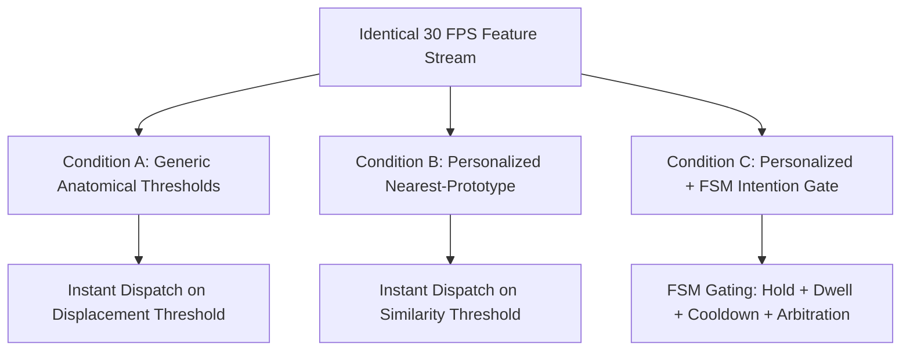

# Research Methodology & Evaluation Standards

**Author**: Pratham Kapoor <prathamkapoor027@gmail.com>  
**Project**: MORPH 2.0 (Intention-Aware Hands-Free Computer Interaction)  
**Location**: `C:\Pratham\MORPH`  

---

## 1. The Core Research Problem

Assistive computer access systems based on facial gestures face a fundamental barrier known as the **"Midas Touch" problem**: human faces are in continuous natural motion during conversational speech, eye blinks, fatigue yawns, swallowing, and emotional expressions. Traditional systems use fixed heuristic thresholds or direct instantaneous classifiers, resulting in hundreds of accidental activations per hour ($>200$ FA/hr).

MORPH 2.0 investigates the following central research question:
> **Research Question**: *Can a webcam-based, user-trained facial gesture recognition system reduce unwanted accidental command dispatches during ordinary movement through a deterministic intent/arbitration finite-state machine, without an unacceptable reduction in intentional-command recall or added latency?*

### Formal Hypotheses
- **$H_1$ (Safety)**: Condition C reduces Unintended Activations per Non-Command Hour ($FA/hr$) by at least 50% relative to Condition B, approaching zero.
- **$H_2$ (Recall)**: Condition C maintains Intentional Gesture Recall $\ge 90\%$ of Condition B's recall.
- **$H_3$ (Predictable Latency)**: Condition C adds a deterministic, bounded confirmation latency equal to $T_{hold}$ (within $\pm 33$ ms frame jitter).

---

## 2. Experimental Conditions (A/B/C)

To prevent evaluation bias and benchmark data leakage, all three conditions are evaluated on the **exact identical stream of recorded feature vectors**:

1. **Condition A (Generic Thresholds)**:
   - Uses hardcoded anatomical displacement rules (e.g. eyebrow elevation $\Delta y > 0.08$ normalized units).
   - Fires immediately on the first frame where threshold is breached.
2. **Condition B (Personalized Prototype / KNN)**:
   - Uses user-calibrated gesture prototypes (cosine similarity) with distance threshold and margin rejection.
   - Fires immediately on the very first frame exceeding the similarity threshold.
3. **Condition C (MORPH: Personalized + Deterministic Intention Gate)**:
   - Receives the exact per-frame similarity scores produced by Condition B.
   - Enforces $T_{hold}$ temporal confirmation (default 250 ms), explicit neutral release dwell (default 150 ms), refractory cooldown (default 300 ms), and geometric conflict arbitration.

---

## 3. Ground Truth & Event Matching Mathematics

### 3.1 Greedy Bipartite Event Matching
For each dispatched command event $D_j$ at monotonic timestamp $t_{D_j}$:
1. Search all ground truth events $G_i$ with matching label within tolerance window:
   $$t_{G_i, start} - \delta_{early} \le t_{D_j} \le t_{G_i, end} + \delta_{late}$$
   (Tolerances: $\delta_{early} = 100$ ms, $\delta_{late} = 600$ ms).
2. Match to the candidate ground truth event with minimum temporal distance $|t_{D_j} - t_{G_i, end}|$.
3. Each ground truth event $G_i$ is matched at most once. Matched events are removed from subsequent matching.
4. Unmatched dispatches are classified as **False Positives (FP)**.
5. Unmatched ground truth events are classified as **False Negatives (FN)**.

### 3.2 Canonical Exposure Duration & Rates
- **Total Duration ($T_{total}$)**: $t_{max} - t_{min}$.
- **Intended Exposure ($T_{intended}$)**: Merged non-overlapping union of ground truth intervals $[\text{start}, \text{end}]$.
- **Non-Command Exposure ($T_{non\_command}$)**:
  $$T_{non\_command} = T_{total} - T_{intended}$$
  Asserting the invariant $0 \le T_{intended} \le T_{total}$.
- **False Activation Rate ($FA/hr$)**:
  $$\text{FA/hr} = \frac{\text{False Positives}}{T_{non\_command} \text{ (hours)}} = \frac{FP \times 3600}{T_{non\_command} \text{ (seconds)}}$$

---

## 4. Exact Garwood Poisson Confidence Intervals

In small-sample or zero-event conditions ($k=0$ False Positives), standard normal approximation ($\pm 1.96 \sqrt{k}$) breaks down and produces invalid negative rates. MORPH computes exact two-sided 95% Garwood confidence intervals using exact $\chi^2$ quantiles ($\alpha = 0.05$):

$$\lambda_{lower} = \frac{1}{2T} \chi^2_{2k, \, \alpha/2}, \quad \lambda_{upper} = \frac{1}{2T} \chi^2_{2(k+1), \, 1 - \alpha/2}$$

For $k = 0$ observed false activations over non-command exposure $T$:
$$\lambda_{lower} = 0.00$$
$$\lambda_{upper} = \frac{-\ln(0.025)}{T} \approx \frac{3.688879}{T}$$

For the canonical 118.05s benchmark challenge ($T_{non\_command} = 116.45$s = $0.032347$ hours):
$$\lambda_{upper} = \frac{3.688879}{0.032347} = 114.04 \text{ FA/hr}$$

This guarantees that claims of 0.00 FA/hr are reported alongside their exact statistical upper bound ($[0.00, 114.04]$ FA/hr), preventing misleading claims of zero risk.

---

## 5. Research Gaps & Solution Mapping

| Gap ID | Identified Research Challenge | MORPH 2.0 Architectural Solution |
|:---:|:---|:---|
| **G1** | Accidental trigger on twitches/speech | Deterministic 3-state FSM requiring stable hold ($T_{hold} \ge 250$ms) |
| **G2** | Arbitrary non-command rejection | Calibrated cosine similarity margin ($\ge 0.15$) against resting neutral |
| **G3** | Rigid models failing atypical anatomy | Rapid personalized 5-sample enrollment and inter-ocular normalization |
| **G4** | Neutral baseline drift across session | Versioned recalibration and automatic feature distribution drift detection |
| **G5** | Unfair cross-model benchmark leakage | Identical-stream replay harness with held-out synthetic evaluation suite |
| **G6** | Latency vs. safety optimization | Pareto parameter calibration balancing confirmation delay and recall |
| **G7** | Privacy violations in camera AAC | Zero video persistence (ADR-002); volatile in-RAM frames immediately freed |
| **G8** | Non-auditable black-box ML decisions | Explainable telemetry inspector and discrete FSM state transition proofs |
